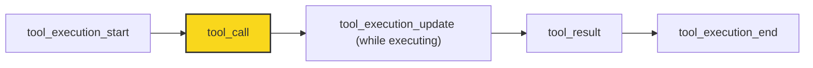

# pi extension API delta: 1.1.0 → 1.4.0

Date: 2026-10-30
Ticket: #82 (parent #80). Question: what changed in pi's extension API between the installed
1.1.0 and the latest 1.4.0, judged against what the submit gate (`extensions/submit-gate.ts`,
spec #54) binds to and what an M5 gate framework would build on.

Source ids used inline:

- [A] pi **1.1.0**, the global install at `$(npm root -g)/@earendil-works/pi-coding-agent/`
  (read only; version confirmed from its `package.json`). Files cited:
  `docs/extensions.md`, `dist/core/extensions/types.d.ts`, `dist/index.d.ts`,
  `dist/core/extensions/runner.d.ts`, `examples/extensions/`.
- [B] pi **1.4.0**, from `npm pack @earendil-works/pi-coding-agent@1.4.0` run inside this repo
  checkout (committed `.npmrc` pins registry.npmjs.org), unpacked to a scratch directory and
  read as data — nothing from the tarball was executed. Files cited: same set as [A].
- [C] `CHANGELOG.md` as shipped in [B], sections 1.2.0 / 1.3.0 / 1.4.0 (1.1.0's own section
  describes the installed build and is used below only to explain a non-delta).
- [D] `extensions/submit-gate.ts` at `main` (1bd513d).

Method: `diff -u` of each file pair, plus grep presence checks for every event name the 1.4.0
docs mention. One trap worth recording: several changelog entries that look like 1.1.0→1.4.0
deltas (`durationMs` on `tool_execution_end`, `aborted` on `agent_settled`, #10549 / #10607)
sit in the changelog's 1.1.0 section — they are already in the installed build and produce no
diff. The changelog sections between the two versions are 1.2.0, 1.3.0, and 1.4.0.

## Verdict

The extension API surface the submit gate binds to is **unchanged**. Between 1.1.0 and 1.4.0:

- **No new events, no new tool-call pipeline stages, no new UI modes.** The `ExtensionEvent`
  union is byte-identical: [A] types.d.ts:1057 equals [B] types.d.ts:1081, member for member.
- **One breaking type change** — `BeforeAgentStartEvent` became a union on `messageType`
  (landed 1.2.0). Theta has no `before_agent_start` handler today, so nothing breaks now.
- **Two additive tool-surface fields** — `reachesTools` on tool definitions (also surfaced
  through `pi.getAllTools()`), and `aliases` on tool namespaces.
- **Behavioral hardening that helps the gate**: concurrent extension dialogs no longer orphan
  each other's promises (1.4.0), and overlay `done()` closes its own overlay (1.3.0).
- **A large documentation rewrite** in [B] docs/extensions.md (274 → 400 lines) that documents
  the pre-existing surface: lifecycle diagrams, ordered hook sequences, a "choose an event by
  intent" table, a handler-composition table that names the **Gate** pattern and fail-closed
  doctrine, and an examples index that points gate authors at `permission-gate.ts`.

Theta can move to 1.4.0 with zero gate changes (peer ranges are already `"*`").

## The tool-call pipeline, as 1.4.0 documents it

All hook names below already existed in 1.1.0 ([A] types.d.ts declares every one); 1.4.0 is the
first version whose docs state their order ([B] docs/extensions.md:59-170). The gate's binding
point is marked.

- The submit gate [D] registers on `tool_call` and returns `{ block: true, reason }` — the
  exact contract the 1.4.0 docs now describe in the Gate row of the composition table:
  "a handled input, blocked tool call, cancelled session operation, or handled `user_bash`
  command stops that operation's normal fallback path" ([B] docs/extensions.md:210).
- The docs add fail-closed doctrine for gates: "gate handlers should fail closed when their
  safety decision cannot be made" ([B] docs/extensions.md:214). The gate currently fails open
  in one path — if `getAllTools()` cannot find the tool, `annotations` is undefined and the
  call passes. That is acceptable today (the tool must exist to be called), but M5's framework
  should adopt the documented fail-closed stance.

## Deltas

### 1. Breaking: `BeforeAgentStartEvent` is a union on `messageType`

What changed: in 1.1.0 a flat interface with `prompt: string` and `images?`
([A] types.d.ts:708-716). In 1.4.0 a union: `BeforeAgentStartUserEvent` (`messageType: "user"`,
carries `prompt`/`images`, [B] types.d.ts:725-732) | `BeforeAgentStartCustomEvent`
(`messageType: "custom"`, carries the starting `message`, no `prompt`, [B] types.d.ts:734-739);
union at [B] types.d.ts:742. Cause: `before_agent_start` now also fires for runs started by
`pi.sendMessage(..., { triggerTurn: true })` while idle ([C] 1.2.0 Breaking, #10267 / #5581 /
#10739). The runner's internal `emitBeforeAgentStart(prompt, images, opts)` became
`emitBeforeAgentStart(trigger: BeforeAgentStartTrigger, opts)` ([B] runner.d.ts). New type
exports `BeforeAgentStartUserEvent` / `BeforeAgentStartCustomEvent` from the package root
([B] dist/index.d.ts).

Breaking or additive: **breaking** for TS consumers that read `event.prompt` unconditionally;
additive at runtime for everyone else (handlers still fire).

Theta relevance: no `before_agent_start` handler exists today, so the break is dormant — but
any M5 framework handler that injects prompt context must guard with
`event.messageType === "user"` (the pattern pi's own `plan-mode` example now demonstrates,
[B] examples/extensions/plan-mode/index.ts:200-202).

### 2. Additive: `reachesTools` on tool definitions and `ToolInfo`

What changed: `ToolDefinition.reachesTools?: (input) => "all" | readonly string[]` ([B]
types.d.ts:490) — a tool that reaches other tools (codemode, tool_search) declares which tools
a call may reach; the MCP extension uses it to finish registering still-connecting servers'
tools from its own `tool_call` handler before the call runs ([B] docs/extensions.md:295, [C]
1.2.0 Added). `ToolInfo` — what `pi.getAllTools()` returns — now Picks `"reachesTools"` too
([B] types.d.ts:1577; [A] types.d.ts:1553 for the old Pick; [B] docs/extensions.md:277).

Breaking or additive: **additive** (optional field; `ToolInfo` widened).

Theta relevance: the gate's `pi.getAllTools()` lookup keeps working unchanged, and its results
gain a field it can ignore; if theta-compute tools are ever reached through codemode or
tool_search, `reachesTools` is the declared way for the MCP extension to wait for a
still-connecting gateway before the call executes — a gate sitting in front of that flow sees
the call only after registration finished.

### 3. Additive: `aliases` on tool namespaces

What changed: `ToolNamespace.aliases?: readonly string[]` ([B] types.d.ts:418) — other names a
script may look the namespace up by (codemode `describeNamespace()`, `searchTools()`'s
namespace option); MCP namespaces alias the server name ([C] 1.2.0 Added).

Breaking or additive: **additive**.

Theta relevance: cosmetic for Theta today; if M5+ exposes gateway tools to codemode scripts,
the `mcp__theta_compute` namespace can carry the plain server name as an alias for lookup.

### 4. Behavior: concurrent extension dialogs no longer orphan each other

What changed: in interactive mode, a second `select`/`confirm`/`input`/`editor` dialog (or
inline `custom()` component) used to replace the first, whose promise then never settled;
closing the visible dialog now restores the previous one ([C] 1.4.0 Fixed, #11166 / #9909).
Related 1.3.0 fix: `done()` of `ctx.ui.custom({ overlay: true })` closes its own overlay, not
the topmost one ([C] 1.3.0 Fixed, #10648 / #10999). The `confirm` signature itself is
unchanged: `confirm(title: string, message: string, opts?): Promise<boolean>` ([A]
types.d.ts:76 = [B] types.d.ts:76).

Breaking or additive: **behavioral fix**, no signature change.

Theta relevance: this is the most gate-relevant delta — the submit gate's entire user surface
is one `ctx.ui.confirm` [D:54]; under 1.1.0, another extension opening a dialog while the gate
waits could hang the gate's promise forever. An M5 framework that stacks several gates (or a
gate plus any other dialog) is only safe from 1.4.0.

### 5. Behavior: the session counts as busy while a run starts

What changed: during run startup, including `before_agent_start` handlers, `ctx.isIdle()` is
false, `pi.sendMessage()` queues into the starting run instead of failing with "Agent is
already processing", `pi.sendUserMessage()` now requires `deliverAs`, and an abort requested
meanwhile aborts the run once it starts ([C] 1.2.0 Breaking, #10739). The 1.4.0 docs also
state that retries, recovery, compaction, and queued work can start another run after
`agent_end`, so `agent_end` is not a final-idle signal ([B] docs/extensions.md:166).

Breaking or additive: **behavioral** (breaking for code that relied on idle windows).

Theta relevance: any M5 orchestration that injects messages around runs (for example, a gate
framework that queues a follow-up after refusing a call) must treat the startup window as busy
and pick a `deliverAs` strategy.

### 6. Behavior: extension tools stay active across resume and tree navigation

What changed: resumed sessions and `/tree` navigation used to leave extension tools inactive
when the branch recorded its tools before they were registered; such tools are now active
unless registered with `defaultActive: false` ([C] 1.4.0 Fixed, #11062 / #11075; 1.3.0 Fixed
#10785 for resume).

Breaking or additive: **behavioral fix**.

Theta relevance: gateway tools (MCP) surviving session resume removes a class of
"gate silently absent in a resumed session" risk for M5.

### 7. Behavior: `before_provider_headers` sees fewer provider-identity headers

What changed: extensions' `before_provider_headers` handlers no longer see the OpenRouter,
NVIDIA NIM, and OpenCode provider-identity headers (pi's changelog calls them provider
attribution headers); returning `null` for one still removes it ([C] 1.4.0 Changed).

Breaking or additive: **behavioral**, narrow.

Theta relevance: none today — Theta has no provider-header handler.

### 8. Docs only: the 1.4.0 extensions.md rewrite

What changed ([B] docs/extensions.md, all hunks verified against [A] — every API name cited
already exists in [A] types.d.ts):

- Lifecycle mermaid diagrams and the ordered hook lists for the model request
  (`context` → `context_with_system` → `before_provider_headers` → `before_provider_request`
  → `after_provider_response` → stream events) and for tool execution (diagram above), lines
  59-140.
- A "lifecycle involves these event groups" table (lines 133-141) and a "choose an event by
  intent" table (lines 147-160) — e.g. "Authorize or modify a tool call → `tool_call`";
  "Redact, annotate, or replace a tool result → `tool_result`".
- The handler-composition table (lines 203-212) naming the **Gate** pattern (cited above) and
  the fail-closed doctrine (line 214).
- `before_agent_start` `messageType` guidance (line 216).
- `pi.getAllTools()` documented as reporting `exposure`, `namespace`, `annotations`, and
  `reachesTools` (line 277) — matching delta 2.
- An examples index (lines 383-396) whose first row sends gate authors to
  `examples/extensions/permission-gate.ts`: "Combines `tool_call`, mode-aware UI, and
  fail-closed behavior" (line 390). That example file is **byte-identical** in [A] and [B] —
  it existed in 1.1.0; only the pointer is new.

Breaking or additive: **documentation only** — but it changes what pi's docs convention (this
repo's CLAUDE.md reads the extension API from the installed package) will tell M5 authors.

Theta relevance: M5's gate framework gets, for free, an upstream-endorsed vocabulary (gate,
fail-closed, mode-aware confirmation) and a canonical example to diff against; the repo's
"read the API from the install root" rule now yields substantially better doctrine at 1.4.0.

### 9. Not deltas (checked, identical in both)

- The `ExtensionEvent` union ([A] types.d.ts:1057 = [B] types.d.ts:1081): `project_trust`,
  `resources_discover`, `mcp_servers_change`, session events (`session_start`,
  `session_shutdown`, `session_before_switch` / `_fork` / `_compact` / `_tree`,
  `session_compact`, `session_compact_failed`, `session_info_changed`, `session_tree`),
  `input`, `before_agent_start`, `agent_start` / `agent_end` / `agent_before_settle` /
  `agent_settled`, `turn_start` / `turn_end`, `context` / `context_with_system`,
  `before_provider_headers` / `before_provider_request` / `after_provider_response` /
  `provider_stream_event`, `message_start` / `message_update` / `message_end`,
  `tool_execution_start` / `tool_execution_update` / `tool_execution_end`, `tool_call` /
  `tool_result`, `cache_warming_decision`, `user_bash`, `model_select`,
  `thinking_level_select`, UI prompt events. All present in 1.1.0.
- `ToolCallEventResult` `{ block?, reason?, terminate? }` ([B] types.d.ts:1089-1097) — the
  `terminate` hint (stop the batch after this refusal) already exists in 1.1.0; an M5 gate can
  use it today without any version move.
- `ctx.ui.confirm` signature ([A]/[B] types.d.ts:76), the `ExtensionAPI` method set
  (`on`, `getAllTools`, `registerTool`, `sendMessage`, ...), `ToolAnnotations` semantics
  (`readOnlyHint`, `destructiveHint`, `idempotentHint`, `openWorldHint`, MCP defaults, "a
  permission extension can use them to decide which calls to confirm" — [B]
  docs/extensions.md:279-288, unchanged paragraph), `ExtensionMode` / mode-aware UI surfaces,
  `prepareLoadout`, `ToolExposure` values.
- Minor root-export addition not otherwise relevant: `formatReadLineRange` ([B]
  dist/index.d.ts; from [C] 1.3.0 Fixed #9887) — a rendering helper, no gate bearing.

## Submit-gate impact matrix

| Gate binding ([D]) | Status at 1.4.0 | Citation |
|---|---|---|
| `pi.on("tool_call", handler)` | unchanged | [B] types.d.ts:1224 |
| `pi.getAllTools()` → `.annotations.destructiveHint` | unchanged; result type `ToolInfo` gains optional `reachesTools` | [B] types.d.ts:1284, 1577 |
| `ctx.ui.confirm(title, message)` | signature unchanged; concurrency orphaning fixed | [B] types.d.ts:76; [C] 1.4.0 Fixed #11166 |
| return `{ block: true, reason }` | unchanged; `terminate` hint available since 1.1.0 | [B] types.d.ts:1089-1097 |
| `mcp__theta_compute__` prefix assumption | unchanged: `createMcpToolName`'s sanitization is byte-identical in both | [A]/[B] `dist/extensions/mcp/tools.js` |

## What an M5 gate framework can build on

Already present in 1.1.0 and now documented with order and doctrine at 1.4.0 ([B]
docs/extensions.md:133-216):

1. The **Gate composition pattern** — `tool_call` (authorize/modify/block), `user_bash`
   (intercept shell commands), `session_before_switch` / `session_before_fork` (cancel session
   operations), `input` (handle raw input) — each stops the operation's fallback path.
2. **Fail-closed doctrine** for safety decisions, now explicit upstream.
3. **`tool_result` chaining** — redact, annotate, or replace results; handlers compose, each
   seeing prior changes ([B] docs/extensions.md:219) — the natural hook for an M5 post-run
   attestation leg.
4. **`agent_before_settle`** — append entries or request one continuation before the run
   settles; `agent_settled` for notification-only work ([B] docs/extensions.md:170-175).
5. **`cache_warming_decision`** — "last override wins" composition ([B]
   docs/extensions.md:211).
6. **`project_trust`** — a decision surface that runs before trusted project resources load
   ([B] docs/extensions.md:151-153) — the model for a Theta-side trust boundary if M5+ gates
   project resources.
7. **Mode-aware confirmation** — the upstream `permission-gate.ts` example (identical in both
   versions) combines `tool_call`, `ctx.ui` mode checks, and fail-closed returns; it is the
   reference shape for generalizing `extensions/submit-gate.ts` beyond the gateway namespace.

Recommendation: the M5 framework needs no 1.4.0-only API — every hook it would build on exists
in the installed 1.1.0. Moving to 1.4.0 is still worth it for the concurrent-dialog fix (delta
4) and the docs doctrine, and it costs nothing: no gate code change, peer ranges already `"*"`.

## Public-hygiene note

This note names no cluster accounts, hosts, or credential material; the gateway is referred to
by its public skill/server name only.
